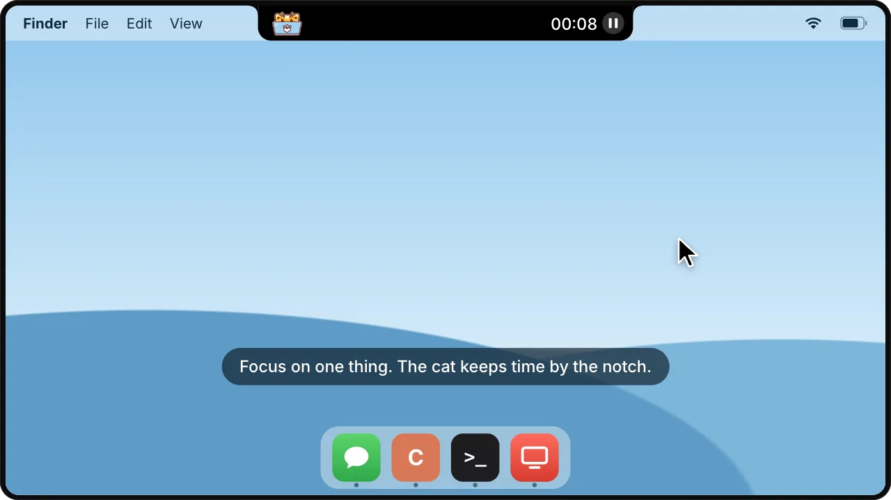

<!-- For whoever edits this file (GitHub doesn't show this): the top, from the icon to the animation, stays as it is.
New features go under "What it does": a line in their section's intro if it's big, otherwise into its <details> list;
"Why Meowdoro" changes only when something big does. The animation is site/hero/readme.html rendered into
assets/demo.webp (site/README.md says how); render it again when the island looks different. app/scripts/release.sh
and remote/publish.sh run public/check.sh, which refuses a README that lost the animation. -->

<p align="center">
  
</p>

<h1 align="center">Meowdoro</h1>

<p align="center">
  <b>Your agents don’t need breaks. You do.</b><br>
  A pomodoro timer in your Mac’s notch that also keeps an eye on Claude Code and Codex.
</p>

<p align="center">
  <a href="https://github.com/lc66/meowdoro-public/releases/latest/download/Meowdoro.dmg"></a>
  
  
</p>

<p align="center">
  <a href="https://github.com/lc66/meowdoro-public/releases/latest/download/Meowdoro.dmg"><b>Download for Mac</b></a> ·
  <a href="https://meowdoro.com">meowdoro.com</a> ·
  <a href="CHANGELOG.md">What’s new</a> ·
  <a href="#agents-on-other-machines">Agents on other machines</a>
</p>

<p align="center">
  
</p>

AI agents can work all day. People can't, and shouldn't have to. Meowdoro keeps a simple rhythm by the notch — 25 minutes on one thing, then a real break — and watches your Claude Code and Codex sessions for you. During a focus, the island shows which agents are working, finished or waiting for you. During a break they keep working, and their news waits until you're back.

This repository holds Meowdoro's releases and the helper for agents on other machines. The app's source isn't here.

## Why Meowdoro

- **A rhythm for you, not for the agents** — focus, short break, long break after four rounds, by the notch. All of it adjustable.
- **Your agents at a glance** — Claude Code in the terminal or Claude Desktop, Codex in the terminal or ChatGPT, on this Mac and on other machines. One click opens a session.
- **Quiet** — no Dock icon and no notification banners: one line slides out of the island, and during a break nothing reaches you.
- **It only listens** — it never approves anything, never slows an agent down and never edits your agents' settings.
- **Yours** — settings and statistics stay on your Mac. No account, no analytics.
- **A cat by the notch** — at its laptop during a focus, with a mug on a break.

## Install

**[Download Meowdoro](https://github.com/lc66/meowdoro-public/releases/latest/download/Meowdoro.dmg)** (a DMG). What changed in each version: [CHANGELOG.md](CHANGELOG.md); older versions and their notes: [Releases](https://github.com/lc66/meowdoro-public/releases).

- macOS 14 or later, Apple silicon or Intel. On a Mac without a notch it's a small bar in the middle of the top edge.
- This test version isn't signed by Apple yet, so macOS refuses the first launch. Drag Meowdoro to Applications, then run this once in Terminal:

  ```sh
  xattr -dr com.apple.quarantine /Applications/Meowdoro.app
  ```

  The read-me inside the DMG walks through it. Once the app is signed, this step goes away.
- From 0.1.13 Meowdoro updates itself: once a day it looks for a newer version, says so in the island, and installs it when you press Install. Updates are signed, and Meowdoro installs only ones signed with its own key. Settings has the switch and Check Now; right-click the island for Check for Updates. Versions before 0.1.13 need this one installed by hand.
- No Dock or menu bar icon: click the island to open it, right-click it for Settings and Quit.

## What it does

### A focus timer around the notch

Focus, short break and long break by the notch, with a cat that keeps the time. The island is the notification: no Dock icon, no banners.

<details>
<summary>Everything the timer does</summary>

- Focus, short break and long break: 25, 5 and 15 minutes, the long break after 4 rounds. All of it is adjustable.
- A cat sits next to the notch: at its laptop during focus, with a mug on a break. When a phase ends, the island slides out with a bigger cat and what comes next. No Dock icon, no notifications: the island is the notification.
- The time in the notch as digits, a ring or a bar, counting down or up. It flashes when a minute is left.
- After a phase ends the time keeps counting up (+3:12) until you start the next one, or the next phase starts on its own. After 4 hours with nothing running (a night away), the timer starts over from the first round.
- Click "Focus" in the island to name what you're working on.
- If you want, a focus pauses after 5 minutes without keyboard or mouse, or during a call (camera or microphone in use), with the time rewound to when it began; the island says so, and offers Resume once you're back. Both are off by default.
- A purr, a beep or nothing when a phase ends, at its own volume.
- Do Not Disturb during focus, through two Shortcuts (only Shortcuts can switch a Focus on macOS). "Add Do Not Disturb shortcuts" in Settings adds Meowdoro's own in two clicks.
- On the screen with the notch or on the main display; it can hide over full-screen apps.

</details>

### Your agents at a glance

Claude Code (in the terminal or Claude Desktop) and Codex (in the terminal or ChatGPT) show up in the island. Settings → Agents on this Mac shows a tile for each agent it finds, with a green ring once it's connected; Connect (or "Connect all…") installs a small plugin into each.

<details>
<summary>Everything about agents</summary>

- Every session with what it's doing: working, waiting for you, finished, failed, grouped by agent. A click opens it in Claude Desktop or ChatGPT.
- A session you've read — in the island, or in Claude Desktop or ChatGPT — dims and leaves 15 minutes later. One whose turn ended on a question for you (Claude Desktop's yellow dot) waits, with the question.
- A ring shows how full each session's context is. Past a threshold (50% by default), the break card suggests `/compact`.
- Codex's 5-hour and weekly limits on this Mac, and when they'd run out at the current pace.
- Sessions that work in Figma, Canva and other design tools over MCP say so: "→ Figma", and a right-click opens the Figma file.
- During focus, agent updates can wait until you peek; during breaks they always wait. Meowdoro only listens: it never approves anything and never slows an agent down.

</details>

### Statistics

The day, the week or the month: focus time, finished sessions, rest, and the work-to-rest ratio, with a chart by hour or by day.

<details>
<summary>Projects and the journal</summary>

- **Projects:** a focus with agents on screen counts in full for every project worked on during it: its agents did something, or you wrote to them or opened their session. Reading an agent's answer counts too: if no agent moved during the focus, it goes to the ones that finished in the break before it. With agents hidden, a focus counts for no project.
- **Journal:** every focus and break of the day, with its name and projects. Rename a focus, or delete a record entered by mistake.

</details>

### Privacy

Settings and statistics stay on your Mac. No account, no analytics. Meowdoro connects to nothing on the internet, except the relay when you turn on agents on other machines, and through it gets only encrypted status.

## Agents on other machines

Meowdoro can show agents that run on a VM, a Linux server or another Mac. The helper here sends their status from that machine to your Mac:

```
that machine                                                              relay              your Mac
agent hook → meowdoro-remote hook → meowdoro-remote daemon ──HTTPS──▶ (sees only ciphertext) ──▶ Meowdoro
```

Meowdoro shows the line in Settings → Remote agents. It looks like this:

```sh
curl -fsSL https://raw.githubusercontent.com/lc66/meowdoro-public/main/install.sh | sh -s -- https://<relay> <code> [name]
```

<details>
<summary>How the helper works, updating and removing it</summary>

- Needs `python3` (3.8+, standard library only) and `curl`.
- `install.sh` downloads the helper of its own release by tag and runs it only if its SHA-256 matches.
- `<code>` carries the channel and the encryption key made on your Mac; it is saved to `~/.meowdoro/remote.json` (owner-only).
- It finds Claude Code and Codex on PATH, in the usual install folders, and on a Mac inside Claude Desktop and ChatGPT too. Right after setup your Mac lists the machine in Settings → Remote agents.
- The helper's plugin, `meowdoro-remote`, is installed into Claude Code and Codex with their own commands. Codex runs plugin hooks only after you trust them (`/hooks`), and your Mac says so until you do. An agent installed there later gets the plugin by itself; one you switch off stays off.
- Agents load plugins when a session starts. Claude Code sessions that were already open send nothing until you type `/reload-plugins` in them or restart them: setup names them, and your Mac lists them in grey with that hint until they do. Codex sessions that were open pick it up after a restart.
- Claude Code needs 2.1.89 or newer for the plugin's hooks. An older one gets the plugin anyway, and your Mac says to update it; sessions started after the update show up by themselves, no need to run the line again.
- Settings → Remote agents shows each machine's agents: connected, waiting for Codex's hooks to be trusted, too old, or not there.
- On a machine that runs Meowdoro too (a Mac VM, say), its own plugin and the helper's work side by side: the agents there show up in that machine's island and on your Mac.
- Several Macs can watch the same machine: run each Mac's line there. The helper sends to all of them (up to 8), each sealed with its own key. `python3 ~/.meowdoro/bin/meowdoro-remote list` shows them, `… remove <number>` stops one.
- Update: run the line again (Settings says when a newer helper is out; it never updates itself). Remove: `python3 ~/.meowdoro/bin/meowdoro-remote uninstall`.

</details>

<details>
<summary>What leaves that machine</summary>

Only status: agent, session id, event (working / waiting / finished / error / closed), project name (the git repository's folder name), the session's title, a tool's name when it asks for permission or is an MCP tool, how full the session's context is, Codex's plan limits, whether you've read a finished session there, the question Claude Desktop says a turn ended on (its own one-line summary), which agents have the plugin, the ChatGPT login Codex uses there as a fingerprint (a hash, not the account or the user) and its email masked to the first two letters and the domain (`gl…@gmail.com`; machines with the same login share their limits on your Mac), Claude Code's version when it's too old for it (and that of each session that sends nothing), the machine's name, the helper's version, a timestamp. Never prompts, tool inputs or outputs, file contents, paths or the agent's replies. Everything is encrypted with AES-256-GCM before it leaves; the relay can't read it.

</details>

## Versions

Meowdoro checks `appcast.xml` in this repository for updates (with [Sparkle](https://sparkle-project.org)): it lists the latest version, its notes, and the DMG's EdDSA signature.

The app and the helper have their own versions: app releases are tagged `app-v<version>`, helper releases `helper-v<version>`. A new helper doesn't need a new app, and the other way round. Each message from the helper carries a protocol version. New helpers only add fields, so an older Meowdoro keeps working with a newer helper (it ignores what it doesn't know, and shows agents it doesn't know yet by their name). A change an older Meowdoro couldn't read would raise the protocol version; that Meowdoro then says the machine needs a newer Meowdoro.
